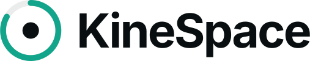

<picture>
  <source media="(prefers-color-scheme: dark)" srcset="assets/kinespace-logo.svg">
  
</picture>

# KineSpace: Devpost submission

**Neck and hand physio in AR, for Spectacles.** Planned with the Devpost Learn skill pack and built with CLAD in Lens Studio.

> **Status:** built and tested in the Lens Studio Preview. It has not run on a Spectacles device yet.

## Elevator pitch

Physio only works if you actually do it. At home, patients forget, get bored, or rush the movements with no one there to correct them.

KineSpace turns Spectacles into an exercise coach that guides seven-minute sessions, two or three times a day, right in front of your eyes. Every button works three ways: pinch it, say it, or just hold your head on it for three seconds. You never have to touch anything.

The Lens finds your neutral head position and how far you can comfortably turn that day. Then it guides finger exercises and slow head turns with a pacing dot. Rushed reps don't count, rests between sets come with a breathing guide, and every session ends with your progress. If anything hurts, the session stops and the next one starts easier.

The project was planned with the Devpost Learn skill pack, then built by an AI coding agent working directly in Lens Studio through MCP. The result: 51 scripts, almost 9,000 lines of TypeScript, and 41 automated flow checks, all passing.

KineSpace: the right exercises, done safely, and actually done.

## In this folder

| File | What it is |
|---|---|
| [`ABOUT.md`](ABOUT.md) | About the project: inspiration, what it does, how we built it, challenges, and what's next. |
| [`TECHNOLOGY.md`](TECHNOLOGY.md) | How KineSpace meets the main technology requirement, with every product we used and what it does. |
| [`assets/`](assets) | Logo files (SVG) for dark and light backgrounds. |

## Planning and verification documents in this repo

| Document | Role |
|---|---|
| [`.claude/agents/lens-studio-agent.md`](../.claude/agents/lens-studio-agent.md) | The agent brief: the platform's hard rules that the AI coding agent follows on every change. |
| [`Assets/Scripts/Config.ts`](../Assets/Scripts/Config.ts) | Every threshold in one file. Each value cites its source, and every therapy value is tagged `TODO: validate with physiotherapist`. |
| [`DEVIATIONS.md`](../DEVIATIONS.md) | Every difference between the build and the design, with the reason, plus the decisions still open for a designer or physiotherapist. |
| [`Assets/Scripts/Dev/FlowSelfTest.ts`](../Assets/Scripts/Dev/FlowSelfTest.ts) | 41 automated checks that drive the real state machine through the whole session. |
| [`Docs/Review/`](../Docs/Review) | Side-by-side comparisons of the design and the Lens Studio Preview, phase by phase. |
| [`Docs/DEVICE_TEST_CHECKLIST.md`](../Docs/DEVICE_TEST_CHECKLIST.md) | What still has to be checked on a Spectacles device. |
| [`README.md`](../README.md) | How to install, run it in the simulator, the architecture, and how to tune it. |
